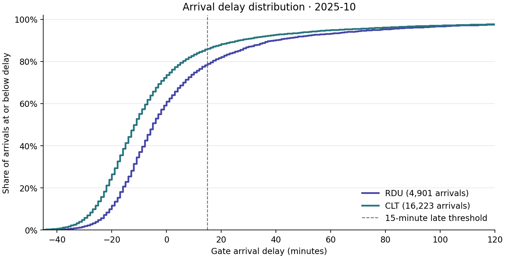

# Flight Delay Explorer

An interactive Digital Method demo using public U.S. Bureau of Transportation Statistics data.
Explore monthly departure delays by origin airport, operating airline, and flight outcome.

## GitHub Pages demo

The static site is in `docs/`. It ships with the July 2019 through August 2026
export and opens on Raleigh-Durham (RDU), January 2024 through the latest available month.
The date picker includes all months in the export. A monthly point covers the entire calendar month.

Run a local preview from the repository root, then open <http://localhost:8000/>.

```shell
python -m http.server 8000 --bind 127.0.0.1 --directory docs
```

On GitHub, choose **Settings → Pages → Deploy from a branch → main → /docs**.
The browser loads a static data manifest and compressed airport files. Only the
airport data needed for the selected filters and comparisons is loaded.

The export keeps exact frequency counts for each observed departure-delay value
by calendar month, origin, operating airline and flight outcome, plus counts of
missing values. Frequencies give exact weighted averages, quantiles, histograms
and ECDFs at that grain. The public demo covers monthly departure delay.
Daily and weekly buckets, destination filtering, and other signals are available in the local Explorer.

## Refresh the public data locally

```shell
python -m pip install -r requirements.txt
python export_pages.py
```

The exporter reads the monthly Parquet partitions in `data/bts/flights/`. To
use a separate directory, run `python export_pages.py --data-root /path/to/data/bts`.
It writes the manifest and compressed summaries under `docs/data/`. Commit those
generated files with the public site. Original downloads and Python caches are ignored.

## Local analysis

The local tools download and convert an inclusive range of national BTS
reporting-carrier data. The October 2025 Raleigh-Durham (RDU) and
Charlotte Douglas (CLT) analysis is the validation baseline.

## Explore a signal

From the repository root, run the following commands with Python 3.11 or later.
On Windows, use `py` in place of `python` if that is your Python launcher.

```shell
python -m pip install -r requirements.txt
python acquire.py --explore
```

The explorer opens locally in your browser. It can start offline after dependencies and local Parquet data are in place.
If you downloaded Parquet already, the explorer uses data under `data/bts/`
by default. Pass `--data-dir` with your existing download folder if you used
a different location. You can move between the downloader and the explorer
using their links. Reload the explorer after adding new months.

1. Pick an inclusive start and end date and one of the numeric signals.
2. Select a daily, weekly, or monthly trend and choose mean, median, P95,
   or valid observation count. Weekly buckets start on Mondays and monthly
   buckets start on the first day, even when a selected period starts later.
3. Apply optional filters for operating airline, origin, destination, flight
   outcome, or minimum and maximum values of the selected signal.
4. Compare by operating airline, origin, or destination. Select up to five
   groups or leave the selection empty to get the three with the most valid
   values. Include **Total** to show all flights that match the filters.
5. Select **Evaluate**. The shared series checkboxes toggle chart traces
   and summary rows together. The charts also support hover, zoom, and image export.

All views use the same record selection. Null or non-finite signal values
are reported as missing and excluded from the plots. The bounds apply only
to valid signal values and are inclusive. Histograms share bin edges across
series and default to share within each series. The central view covers the
span from the lowest P1 to the highest P99 among the evaluated series.
Select **Full** to inspect the tails. The displayed range does not change
summary statistics or which observations count toward each share.
The empirical CDF gives the
exact fraction of valid values at or below each observed value. P95 uses
linear interpolation, and the standard deviation is the sample standard deviation.
Absolute counts are available on the histogram and in the summary table.

The trend uses BTS flight dates. The first increment groups by one dimension
at a time and evaluates one signal at a time. The explorer reports missing
monthly partitions within a selected range so you can distinguish incomplete
coverage from a period with no matching flights.

## Download flight data

Open a terminal in the repository root and run these commands
with Python 3.11 or later. On Windows, `py` also works in place of `python`.

```shell
python -m pip install -r requirements.txt
python acquire.py
```

The picker opens in a browser tab. If it does not open automatically, use the
local URL printed in the terminal. The picker loads actual monthly archive links
from [BTS TranStats](https://www.transtats.bts.gov/PREZIP/) and defaults to
January 2022 through December 2025, inclusive. Change the start and end
dropdowns as needed, then select **Download and convert**. Keep the terminal
running until the picker says the dataset is ready. BTS gaps are shown before
download. If a run stops, select the same interval to reuse verified months.

The default output is `data/bts/` in the project folder. For a four-year run,
allow several gigabytes for archives, Parquet, and a temporary CSV for the month
being processed. Set `--data-dir` to choose a different drive or folder.

```shell
python acquire.py --data-dir "D:/Digital Method/BTS"
```

For a terminal-only run, use `--start` and `--end`. Use `--list` to print
available months.

```shell
python acquire.py --start 2022-01 --end 2025-12
```

| Under `data/bts/` | Contents |
|---|---|
| `raw/` | Original BTS monthly ZIPs |
| `flights/flight_year=2025/flight_month=10/data.parquet` | One Zstandard-compressed Parquet file per month |
| `manifest/2025-10.json` | Source URL, ZIP and Parquet checksums, sizes, row count and flight-date coverage |
| `checks/dot_table5_parquet.csv` | October 2025 DOT reconciliation, generated when the selected range includes that month |

The converter preserves the 109 named fields, converts dates and measurements
to consistent types, and keeps local HHMM clock values as strings. Flight rows
include origin and destination IDs, operating carrier IDs, cancellations,
diversions and delay details. The ZIP and derived Parquet have separate
SHA-256 checksums. The converter validates the schema, month, flight status and
written row count before publishing a partition.

To check what was acquired with DuckDB, run this from the project directory
after downloading at least one month.

```python
import duckdb

duckdb.sql("""
    SELECT flight_year, flight_month, count(*) AS flight_records
    FROM read_parquet('data/bts/flights/flight_year=*/flight_month=*/data.parquet',
                      hive_partitioning = true)
    GROUP BY flight_year, flight_month
    ORDER BY flight_year, flight_month
""").show()
```

## Validate October 2025 from Parquet

October 2025 is checked automatically during acquisition. The SQL check uses
the Parquet file to reproduce both airports' arrival and departure counts and
on-time percentages from Table 5 of the December 2025 DOT report.
You can rerun the comparison by supplying the partition path:

```shell
python verify_parquet.py data/bts/flights/flight_year=2025/flight_month=10/data.parquet
```

The published comparison values are also included in
`results/dot_table5_parquet.csv` from the verified run.

## What the first run found

| Metric | RDU | CLT |
|---|---:|---:|
| Reported arrivals | 4,932 | 16,266 |
| Arrived on time, share of reported arrivals | 77.7% | 85.5% |
| Reported departures | 4,929 | 16,273 |
| Departed on time, share of reported departures | 80.4% | 80.4% |
| 95th percentile of completed-flight arrival delay | 77 min | 62 min |
| Median taxi-out time | 15 min | 18 min |
| 95th percentile taxi-out time | 40 min | 36 min |

The airports had the same published on-time departure percentage to one decimal
place. RDU had a shorter typical taxi-out time and a longer 95th percentile taxi-out
time. This illustrates how a distribution can reveal operational differences that
a single on-time percentage does not show.



## Data and verification

- [BTS Reporting Carrier On-Time Performance in TranStats](https://www.transtats.bts.gov/TableInfo.asp?QO_fu146_anzr=b0-gvzr&gnoyr_VQ=FGJ)
- [October 2025 BTS source archive](https://www.transtats.bts.gov/PREZIP/On_Time_Reporting_Carrier_On_Time_Performance_1987_present_2025_10.zip).
- [December 2025 DOT Air Travel Consumer Report](https://www.transportation.gov/resources/individuals/aviation-consumer-protection/december-2025-air-travel-consumer-report), Table 5. The report issue is December and the flight month is October.
- [BTS study of aircraft taxi times](https://www.bts.gov/archive/publications/special_reports_and_issue_briefs/special_report/2008_008/entire). Earlier work compares taxi times and flight volumes by season, day and hour and examines long taxi-outs.

The script scanned 605,844 flight records nationally. It counted 41,880 records with RDU or CLT as origin or destination.
Flights between the two airports contribute once to each relevant airport-direction group. For each airport and direction,
both the count and the on-time rate match the values published in DOT Table 5, at the report's published precision.
The checks found zero repeated candidate keys, zero missing gate delays among completed non-diverted flights
and zero disagreements between the eligible records' recorded 15-minute delay flags and computed flags.
The candidate key uses flight date, operating carrier DOT ID, reporting carrier flight number,
origin and destination airport IDs, and scheduled departure time. It is a diagnostic and no rows were deduplicated.

On-time means the relevant observed gate time is less than 15 minutes later than scheduled.
Reported operations form the rate denominator, including cancellations and diversions. Cancelled
records contribute no on-time flight. Diverted departures can contribute when an eligible gate departure is available.
The arrival delay distribution uses completed, non-diverted flights with signed `ArrDelay` values, so negative
values indicate early arrivals. Taxi-out uses available `TaxiOut` values for noncancelled departures,
including diversions that have a value. Gate delay and taxi-out duration measure different things.
The percentiles use linear interpolation and the plot shows the empirical cumulative distribution.

The results cover one month, flight records from reporting operating carriers, and unadjusted airport comparisons.
Carrier, route and schedule mixes may explain some differences. Changes across seasons or causes of delays require further analysis.

## Reproduce the original ZIP-based analysis

Use Python 3.11 or later. Run from the extracted folder.

```shell
python -m pip install -r requirements.txt
python analyze.py path/to/october-2025.zip
```

For another month, pass a single BTS monthly ZIP path and a new output directory.
The Table 5 comparison is built in for October 2025.

```shell
python analyze.py path/to/monthly.zip --output results-another-month
```

| Output | Contents |
|---|---|
| `airport_metrics.csv` | Counts, on-time percentages, cancellation and diversion counts, delay and taxi-out percentiles |
| `dot_table5_reconciliation.csv` | Computed results against published counts and rates |
| `data_quality.csv` | Input volume and duplicate candidate count. Group-level delay checks are in the metrics CSV. |
| `arrival_delay_distribution.png` | Arrival delay distributions for RDU and CLT |
| `provenance.txt` | Archive URL, size, internal CSV name and SHA-256 checksum |
